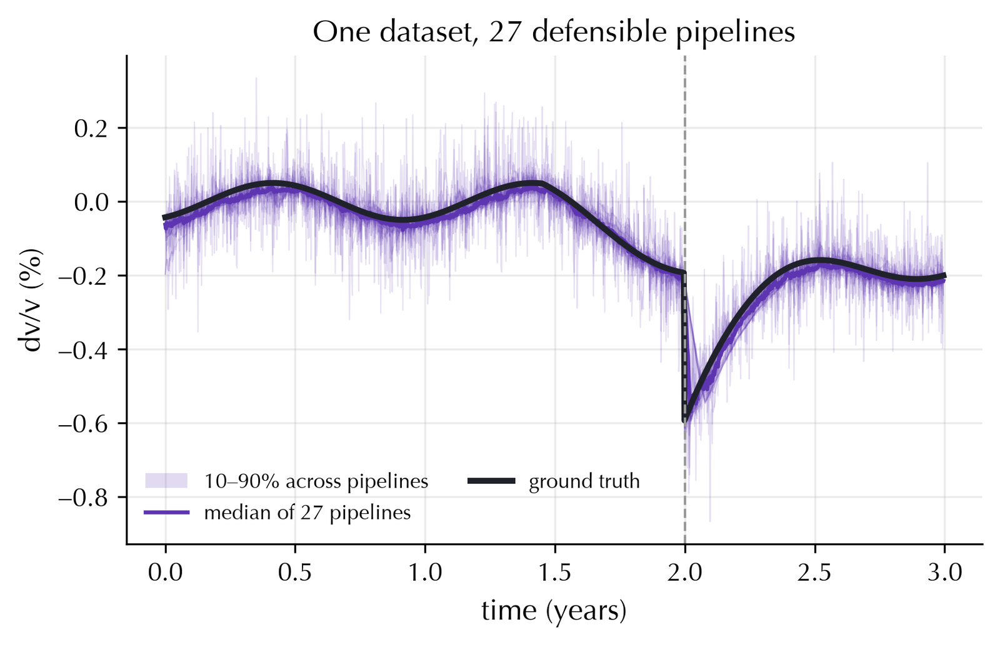
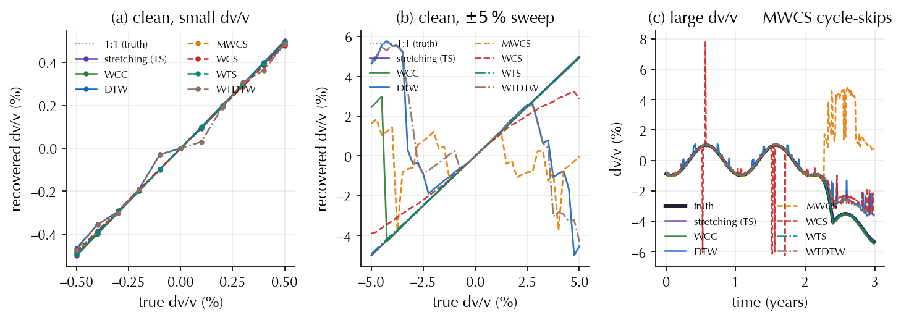
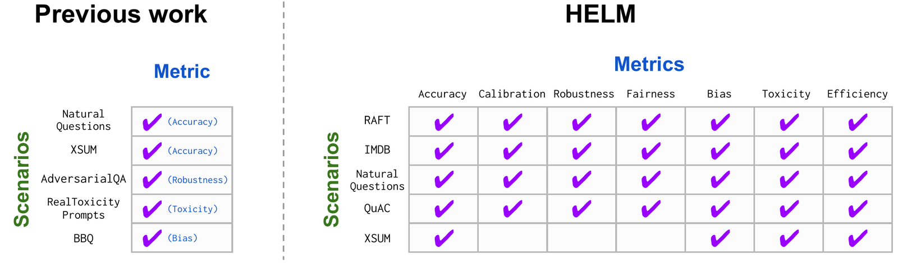
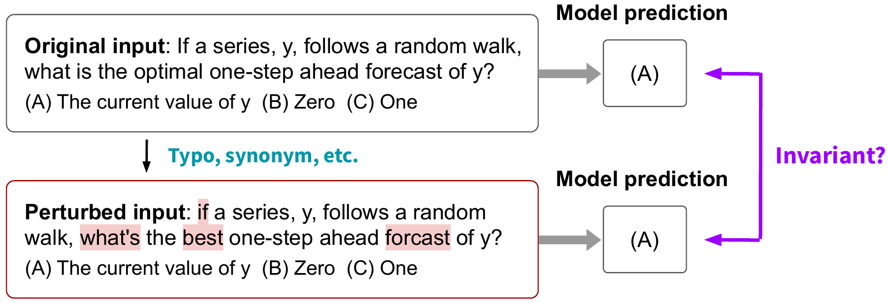
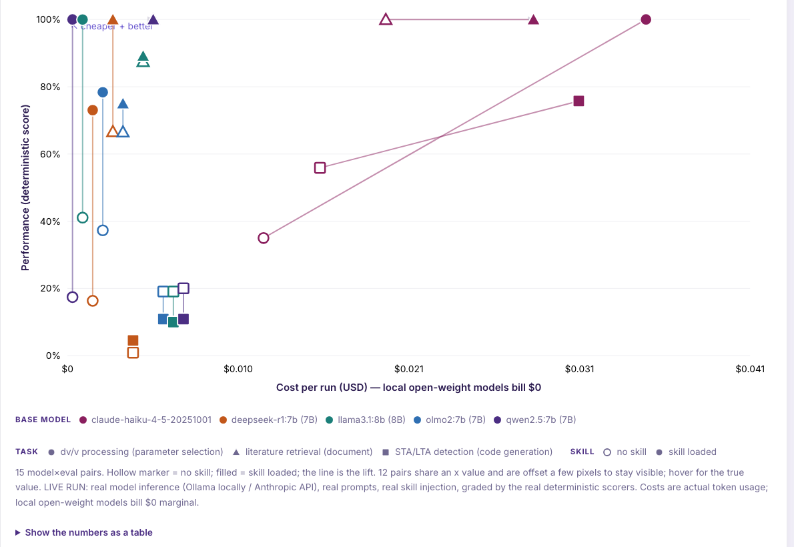
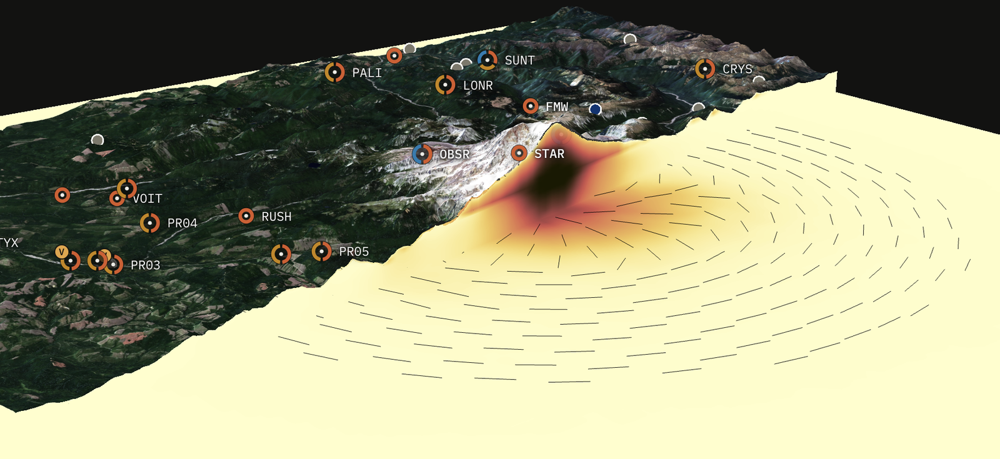

## What should we agree on today?

<!-- Ported from the gaia-agent-evaluations package (Pandoc + vendored Reveal.js) to the
     GAIA Quarto deck series. Wording revised for a geophysics audience on 10 Nov 2026; source lines and repository links
     were added. Content: CC BY 4.0. Code (examples/): MIT. Provenance: SOURCES.md. -->

1. **One task** a SPECFEM agent should complete.
2. **One reference case** we trust enough to evaluate it.
3. **A set of metrics** that reflects scientific quality.
4. **Who** builds the case, connects each agent, and reviews.

::: {.notes}
Purpose: agree on what we should test and how we would recognize success. This is a design discussion, not a benchmark-results presentation. Use the core deck for a 15–20 minute introduction, then discuss. Press N for notes; Escape for overview.

Capture decisions in discussion.md. We do not need to standardize everyone’s agent architecture today. The proposed pilot is a small forward-simulation workflow; the group may select a different first task.
:::

## The evaluation loop

<div class="flow" role="img" aria-label="Task goes to the agent, which produces outputs, which are graded against an independent reference">
<div class="node"><b>Task</b><small>Request + input data</small></div><span class="arrow">→</span>
<div class="node"><b>Agent</b><small>AI model + software tools</small></div><span class="arrow">→</span>
<div class="node"><b>Outputs</b><small>Files + log of steps</small></div><span class="arrow">→</span>
<div class="node"><b>Grading</b><small>Reference answer + rules</small></div>
</div>

**Did the result meet the scientific requirements?**

Repeat across cases and runs; record failures, time, and cost.

::: {.notes}
Task = what we ask. Agent = the complete system under test. Scorer = how we judge the evidence, independently of the agent’s self-assessment. Inputs, tools and budgets are declared before the run. A fluent final message or a zero exit status does not establish scientific correctness.
:::

## A worked example · codameter

<div class="example-label">PROMPT IN · ILLUSTRATIVE</div>
<div class="prompt">“Using these synthetic correlations, recover dv/v. Return your processing configuration, estimates, and validity mask.”</div>

<div class="example-label">OUTPUT FILES</div>

`config.json` → the processing choices  
`dvv.csv` → the estimated series  
`valid.csv` → which estimates are usable

<p class="source">Task adapted from <a href="https://github.com/Denolle-Lab/codameter">codameter</a> · grading as in <a href="https://github.com/mdenolle/repere">Repère</a></p>

::: {.notes}
Grounded in codameter’s documented param_recommendation and dvv_series suites. This combines those concepts into a teaching example; these filenames are a proposed contract, not a claim about the current API. Repère’s README describes numerical regression scoring for coding agents. See docs/SOURCES.md for exact source revisions.
:::

## Agent output against a blind reference

<table class="metrics">
<thead><tr><th>Time</th><th>Agent estimate</th><th>Reference</th><th>Usable?</th></tr></thead>
<tbody>
<tr><td>0</td><td>0.0018</td><td>0.0020</td><td>Yes</td></tr>
<tr><td>1</td><td>0.0021</td><td>0.0020</td><td>Yes</td></tr>
<tr><td>2</td><td>0.0019</td><td>0.0020</td><td>Yes</td></tr>
</tbody></table>

All values are **fractional dv/v**: 0.0020 means 0.2%.

<p class="caption">Invented samples · the agent never sees the reference.</p>

::: {.notes}
The agent’s dvv.csv and valid.csv provide the estimates and mask; the evaluator joins them to the hidden truth on the required time grid. These samples are mock artifacts, not actual measured codameter results. No statistical conclusion can be drawn from three values. The validity mask cannot silently remove difficult samples: coverage is a separate gate.
:::

## Why the agent never sees the reference

{.r-stretch}

<p class="source">27 processing pipelines on one synthetic dataset, against the known truth · <a href="https://github.com/Denolle-Lab/codameter">codameter</a> (MIT), literature/figs/demo_9_multiverse.png</p>

::: {.notes}
Every pipeline here is defensible, and they disagree by more than the signal at times. An agent choosing among them can only be scored against a truth it never saw. With real data there is no truth curve, which is why the golden cases start from synthetics with a known answer. Figure from Denolle-Lab/codameter, MIT licence.
:::

## Turning those outputs into a score

**Error:** mean misfit of 0.0002, 0.0001, 0.0001 = **0.000133**.

**Coverage:** 3 usable estimates out of 3 = **100%**.

**Example pass rule:** error ≤ 0.0002 **and** coverage ≥ 90%.

This example **passes both checks**.

<p class="caption">Teaching thresholds only · real ones need a scientific reason.</p>

<p class="source">Run it: <a href="https://github.com/gaia-hazlab/gaia-hazlab.github.io/blob/main/book/teaching/agent-evaluation/slides/examples/score_toy.py">examples/score_toy.py</a> (offline, invented data)</p>

::: {.notes}
The error metric is mean absolute error in fractional dv/v over valid required samples. Thresholds are invented, not codameter defaults. The real scorer verifies time alignment and mask shape, rejects non-finite values, and makes missing outputs explicit. For a parameter-recommendation task, execute the proposed config and score the recovered series. Run examples/score_toy.py for this exact calculation. A scientific golden dataset needs substantially more coverage than this arithmetic example.
:::

## What a failed check looks like

{.r-stretch}

<p class="source">Recovered against true dv/v for eight methods; (c) shows cycle-skipping at large dv/v · <a href="https://github.com/Denolle-Lab/codameter">codameter</a> (MIT), literature/figs/demo_1_methods.png</p>

::: {.notes}
Panel (a): every method agrees when dv/v is small. Panel (b): some methods break over a ±5% sweep. Panel (c): at large dv/v, MWCS cycle-skips and produces confident wrong values. A mean-error score averaged over easy cases would hide panel (c); a mandatory per-case gate does not. Figure from Denolle-Lab/codameter, MIT licence.
:::

## Proposed SPECFEM prompt and outputs

<div class="example-label">PROMPT IN</div>
<div class="prompt">“Run this approved test model with its fixed setup. Return the vertical seismograms and a record that lets us repeat the run.”</div>

<div class="example-label">OUTPUTS → CHECKS</div>

**Seismograms** → station IDs, units, sampling rate, waveform fit  
**Run record** → input checksums, software version, commands  
**Log** → finished or not, errors, run time

::: {.notes}
Proposal, not an implemented SPECFEM benchmark. Choose the variant, fixture, hardware and reference with the team. Define what “vertical” and the recorded quantity mean: displacement, velocity or acceleration, coordinate conventions and units. Freeze the intended output samples. Do not optimize waveform alignment after seeing the answer unless that is explicitly part of the task’s scoring rule.
:::

## A useful result can be a question

<div class="example-label">PROMPT IN · NO OTHER CONTEXT PROVIDED</div>
<div class="prompt">“Simulate this earthquake and show the waveform at our station.”</div>

<div class="example-label">APPROPRIATE RESPONSE</div>

“Which source, station, Earth model, and simulation setup should I use?”

| Check | Score |
|---|---|
| Asks for source, station, Earth model, setup | 1 each, out of 4 |
| Asks for something it was already given | −1 |
| Claims a run or shows a waveform it did not compute | case = 0 |
: {.rubric tbl-colwidths="[72,28]"}

::: {.notes}
Score = essentials asked out of 4, minus redundant questions, set to 0 if the agent claims a run it did not do. Report the mean score and the rate of false execution claims side by side. Setup means mesh or frequency, duration, and the recorded quantity. This is a different task category from running a complete fixture. Use a reviewed rubric of missing essentials, not exact string matching. If approved defaults are already available, asking again may be unnecessary. Report clarification-task results separately from simulation success. Have humans adjudicate ambiguous responses; use an LLM judge only with a rubric and validation against expert labels.
:::

## Different agents, shared evaluation

<div class="node"><b>Same task, input data, required outputs, and computing budget</b></div>
<div class="compare branching">
<div class="node"><b>↓ Maleen’s agent</b><small>Design: to discuss</small></div>
<div class="node"><b>↓ Marine’s agent</b><small>Tested with Repère</small></div>
</div>
<div class="node merge"><b>↓ Same grading script, results case by case</b></div>

<p class="source">Repère board: <a href="https://mdenolle.github.io/repere/">mdenolle.github.io/repere</a> · source: <a href="https://github.com/mdenolle/repere">mdenolle/repere</a></p>

::: {.notes}
Maleen’s architecture has not been verified; leave space for his explanation. Repère documents InspectAI tasks, solvers and scorers. The entire system is the object of comparison, so internal tools may differ if declared and allowed. For a causal claim about one change, hold the other components fixed: same model with/without a skill, or same agent with a different model. Distinguish that controlled experiment from a system-level comparison.
:::

## Where this sits in GAIA’s plan

<div class="flow" role="img" aria-label="Experts build test cases, which a test runner gives to each agent, producing a score sheet that feeds the board, automatic re-tests and usage tracking">
<div class="node plan"><b>Expert benchmarks</b><small>Experts write test cases</small></div><span class="arrow">→</span>
<div class="node plan"><b>Blind test cases</b><small>Agents never see answers</small></div><span class="arrow">→</span>
<div class="node plan"><b>Test runner</b><small>Runs each agent</small></div><span class="arrow">→</span>
<div class="node plan"><b>Score sheet</b><small>One per run</small></div>
</div>

<div class="three">
<div class="node"><b>↓ Repère board</b><small>Live</small></div>
<div class="node plan"><b>↓ Automatic re-test</b><small>Planned</small></div>
<div class="node plan"><b>↓ Usage tracking</b><small>Planned</small></div>
</div>

<p class="source">Dashed = planned, not running. Repère: <a href="https://mdenolle.github.io/repere/">mdenolle.github.io/repere</a></p>

::: {.notes}
Redrawn from the Lecture 1 diagram (book/img/agents-evaluation.svg) at a readable size. Only the Repère board runs today. The harness, CI gate, Observatory and expert track are in the CSSI plan. The SPECFEM pilot would be the first case run through the harness. The expert track is the platform where experts build and review the golden cases; Lecture 1's diagram uses the same definition. It replaces the earlier description (Gaia Translator, rubric scoring by 15 to 25 reviewers).
:::

## What the boxes mean

| | |
|---|---|
| **Score sheet** | For each agent, case and run: correct? cost? same answer on a rerun? Plus what was used: model, software versions, input data |
| **Automatic re-test** | Whenever someone changes an agent, all cases run again; if the score drops, the change is rejected |
| **Expert benchmarks** | A website where geophysicists write test cases (task, input data, reference answer, tolerance); a second expert checks each case before it is used |
: {.terms tbl-colwidths="[26,74]"}

::: {.notes}
Scorecard: "right" is the score against the hidden reference; "cost" is tokens, dollars and wall time; "reproducible" means the same result on rerun in the same container. The board plots scorecards. CI gate: a GitHub Actions job; the threshold is the last accepted score for that agent, with a tolerance for run-to-run noise. Expert track: record who wrote and who reviewed each case, and the agreement between reviewers; disagreements go back to the author before the case is accepted.
:::

## A benchmark case links inputs to checks

<div class="golden" role="img" aria-label="The task and input data go to the agent and produce outputs. Outputs and an expert reference both go to grading, which gives a result.">
<div class="node"><b>Task + input data</b><small>The agent sees these</small></div><span class="arrow">→</span><div class="node"><b>Agent outputs</b></div>
<div class="node hidden-ref"><b>Expert reference</b><small>The agent never sees it</small></div><span class="arrow">↗</span><div class="node"><b>↓ Grading → result</b><small>Checks + tolerances</small></div>
</div>

A reference needs a documented origin, versions, and an independent check.

::: {.notes}
The top-right node feeds the scorer below it; the expert reference feeds that same scorer diagonally. The golden dataset is not just a set of correct final answers: it includes task context and the rules that settle correctness. Hidden answers must be outside agent-accessible storage; a folder named evaluator/ alone does not enforce isolation. Keep public development cases separate from held-out evaluation cases, preferably by case family.
:::

## Many measures, not one score: HELM

HELM (Stanford, 2022) tested language models on many tasks, with seven measures each:

**Accuracy · Calibration · Robustness · Fairness**  
**Bias · Toxicity · Efficiency**

For GAIA: keep the few that matter for science, and say what we have not tested.

<p class="source">Source: <a href="https://crfm.stanford.edu/2022/11/17/helm.html">Stanford CRFM · HELM (2022)</a></p>

::: {.notes}
HELM = Holistic Evaluation of Language Models. The original work evaluates language models; our proposal evaluates complete scientific agent systems. HELM’s original seven metrics are not a ready-made SPECFEM rubric. The following slides are our proposed adaptation. Fairness, bias and toxicity retain their social meanings; coverage across physical regimes is a separate scientific concern, not a replacement definition of fairness. If GAIA includes public-facing communication, prioritize relevant social-risk evaluation as well. Source details in docs/SOURCES.md.
:::

## HELM: every scenario, every metric

{.r-stretch}

<p class="source">Liang et al. (2022), Holistic Evaluation of Language Models, <a href="https://arxiv.org/abs/2211.09110">arXiv:2211.09110</a>, CC BY 4.0 · Figure: multi-metric evaluation</p>

::: {.notes}
Left: earlier benchmarks measured one metric per scenario. Right: HELM measures all seven metrics on every scenario where they make sense, and leaves blanks where they do not. GAIA should do the same and keep the blanks visible. Reproduced from arXiv:2211.09110 under CC BY 4.0.
:::

## Which metrics should GAIA start with?

<table class="metrics">
<thead><tr><th>Dimension</th><th>Proposed measurement</th></tr></thead>
<tbody>
<tr><td>Scientific correctness</td><td>Pass rate + numerical error</td></tr>
<tr><td>Robustness</td><td>Change in pass rate when the task is reworded</td></tr>
<tr><td>Reproducibility</td><td>Reruns that pass / all reruns</td></tr>
<tr><td>Efficiency</td><td>Wall time, cloud cost, CPU/GPU hours</td></tr>
</tbody></table>

**Discuss:** which must pass, and which are trade-offs?

::: {.notes}
Proposed GAIA measures inspired by HELM’s multi-metric principle. For simulation tasks, define per-case numerical checks and mandatory gates; scientific pass rate is passing attempts / all scheduled attempts under a published failure policy. Robustness uses paired cases with equivalent scientific intent, such as prompt rewording, and reports baseline and variant rates plus their difference. A scientifically changed source is a generalization case, not an invariance test. Reproducibility means an independent rerun of the submitted procedure and artifacts, distinct from running the stochastic agent again. Record cost for failed runs too. Report API and compute separately, adding them only when the accounting basis is clear. Energy or carbon cannot be inferred from token count alone.
:::

## Robustness: same question, reworded

{.r-stretch}

<p class="source">Liang et al. (2022), <a href="https://arxiv.org/abs/2211.09110">arXiv:2211.09110</a>, CC BY 4.0 · Figure: robustness perturbations</p>

::: {.notes}
The paired-variant idea behind the robustness row of our metric table. For SPECFEM, the perturbation is a reworded prompt with the same scientific intent; a changed source or Earth model is a different case, not a perturbation. Reproduced from arXiv:2211.09110 under CC BY 4.0.
:::

## Knowing when the agent is uncertain

**Asking:** does it ask for missing information?

**False alarms:** does it reject a complete, valid case?

**Calibration:** when it says 80% sure, is it right about 80% of the time?

<p class="caption">Asking needs expert judgment; calibration needs many graded answers.</p>

::: {.notes}
Proposed measures: necessary-clarification detection = correctly flagged incomplete cases / all incomplete cases; false-alarm rate = valid cases incorrectly blocked / all valid cases. Keep both denominators visible. Calibration requires a predeclared confidence target (for example, probability the final artifact passes), recorded before scoring, and enough labeled attempts. Use reliability plots and a proper score such as Brier score only when probabilities are available. Scientific uncertainty intervals on waveforms or inferred parameters are a separate calibration target. “Asks a question” alone is not evidence of calibrated confidence.
:::

## A metric needs an agreed definition

**Quantity** — waveform relative L2 error, with units and sampling fixed.

**Rule** — compare each required receiver to the reviewed reference.

**Threshold** — set before evaluation; justify it scientifically.

**Failures** — missing traces, NaNs, or timeouts count as failures, not gaps.

::: {.notes}
Example definition for a nonzero reference: e = ||agent − reference||₂ / ||reference||₂, using a fixed time grid, quantity and component; all required receivers must satisfy their individual tolerances. Specify a separate absolute-error rule for zero or near-zero reference energy, chosen before evaluation. Timing, amplitude, phase and frequency content may require separate checks; the group must decide what is scientifically meaningful. A tolerance is not universal across SPECFEM variants or hardware. Infrastructure incidents should be identified and handled under a predeclared rerun policy, with original attempts retained.
:::

## A leaderboard makes trade-offs visible

<table class="leaderboard">
<thead><tr><th>Agent</th><th>Pass</th><th>Median time</th><th>Cloud $ / run</th></tr></thead>
<tbody>
<tr><td>Agent A</td><td>8 / 10</td><td>4 min</td><td>$0.40</td></tr>
<tr><td>Agent B</td><td>9 / 10</td><td>7 min</td><td>$1.10</td></tr>
<tr><td>Agent C</td><td>6 / 10</td><td>2 min</td><td>$0.15</td></tr>
</tbody></table>

<p class="caption">Fictional results · 10 simulation cases · 1 attempt per case · same limits</p>

B passed more cases. A cost less. **What minimum quality do we need?**

<p class="source">GAIA boards: <a href="https://gaia-hazlab.github.io/book/hazevalhub">HazEvalHub</a></p>

::: {.notes}
All values are invented. Rank neither reliability nor statistical significance from this tiny example. API cost is only model API spend, excluding simulation compute. Median time and mean API spend include failed attempts. Real result records also need CPU/GPU hours and hardware, dataset and scorer versions, agent/model revisions, budgets, repetitions and uncertainty. Show simulation and clarification suites separately. Drill into per-case outputs and traces. The toy output-scoring example is separate from these invented table values.
:::

## A board that runs today: Repère

{.r-stretch}

<p class="source">Cost against score, with and without a geophysics instruction file (“skill”) · <a href="https://mdenolle.github.io/repere/">mdenolle.github.io/repere</a> (MIT), captured 9 November 2026</p>

::: {.notes}
Real runs, unlike the previous slide. Hollow markers are runs without a domain skill, filled markers with it; the line between them is the skill lift. Repère already lists slots for SPECFEM, RCA Atlas Q&A and RCA Atlas agent tasks, marked "soon". Screenshot of the live board on 9 November 2026; check the board for current values before quoting numbers.
:::

## HazEvalHub: one board per hazard

<div class="tracks">
<a class="track" href="https://seisscoped.org/QuakeScope/benchmark_summary.html"><b>Earthquakes</b><small>Live</small></a>
<a class="track" href="https://gaia-hazlab.github.io/book/hazevalhub-landslides"><b>Landslides</b><small>Live</small></a>
<a class="track" href="https://gaia-hazlab.github.io/book/hazevalhub-floods"><b>Floods</b><small>Planned</small></a>
<a class="track" href="https://gaia-hazlab.github.io/book/hazevalhub-thunderstorms"><b>Thunderstorms</b><small>In progress</small></a>
<a class="track" href="https://gaia-hazlab.github.io/book/hazevalhub-rainfall"><b>Atmospheric rivers</b><small>In progress</small></a>
<a class="track" href="https://mdenolle.github.io/repere/"><b>Agents</b><small>Live</small></a>
</div>

Each track: tasks, a short test-set description, one ranked table per task.

<p class="source"><a href="https://gaia-hazlab.github.io/book/hazevalhub">gaia-hazlab.github.io/book/hazevalhub</a> · metrics: <a href="https://gaia-hazlab.github.io/book/hazevalhub-metrics">hazevalhub-metrics</a></p>

::: {.notes}
The hub as merged in PR #54. Earthquakes and Agents link straight to the external boards (QuakeScope, Repère). Landslides has three tasks: L1 event classification (7 models), L2 continuous detection at Mount Rainier (1 model), L3 susceptibility at Stehekin (no entries yet). Floods, thunderstorms and atmospheric rivers have pages but no ranked results. Agent evaluation from this lecture lands in the Agents track.
:::

## A real board: landslide event classification

| Model | F1 % | Model weights | Memory MB |
|---|--:|--:|--:|
| SeismicCNN (2D) | 94 | 1,986,572 | 11.6 |
| QuakeXNet (2D) | 92 | 70,708 | 1.2 |
| QuakeXNet (1D) | 92 | 657,716 | 4.6 |
| Random forest (M6) | 89 | n/a | n/a |
: {.evalsets tbl-colwidths="[40,15,25,20]"}

<p class="caption">F1 balances missed and false detections · 8,000 test seismograms; earthquake, explosion, surface event, noise · Kharita et al. 2026, Seismica</p>

QuakeXNet (2D): 2 points lower, 28× fewer weights. **Same question: what minimum quality do we need?**

<p class="source">Board: <a href="https://gaia-hazlab.github.io/book/hazevalhub-landslides">HazEvalHub · Landslides</a> · paper: <a href="https://doi.org/10.26443/seismica.v5i1.2068">10.26443/seismica.v5i1.2068</a></p>

::: {.notes}
Top four of seven rows from data/hazevalhub/landslides_classification.csv, which copies the published tables; nothing was recomputed. Classes: earthquake, explosion, surface event, noise; 2,000 test traces per class. F1 as reported in the paper (macro or weighted not stated; to confirm with Akash). Parameters 1,986,572 / 70,708 = 28.1. Random-forest rows have no parameter or memory figures in the paper. The structure matches the fictional table earlier: a quality column and a cost column, and the choice depends on the floor.
:::

## What else belongs beside the ranking?

**Per-case results** — which scientific setups fail?

**Repeatability** — how often does the same task succeed?

**Robustness** — does rephrasing the task change the outcome?

**Missing coverage** — what have we not tested yet?

::: {.notes}
HELM motivates reporting coverage gaps and multiple dimensions, not a single universal score. Publish counts by task category and scientific regime. Repeated runs are correlated within case: keep per-case repeats visible and account for clustering in uncertainty estimates. Report a transparent-script or human-reviewed procedure as a baseline where feasible. It helps identify whether the agent adds value to running an existing workflow. Do not tune prompts against held-out answers.
:::

## A first set of four test cases

**Reproduce** — rerun an approved reference model.

**Bad input** — a known error the agent must catch.

**New setup** — a reviewed change of source or stations.

**Missing information** — the agent must ask.

::: {.notes}
Proposed categories, not an existing validated SPECFEM suite. Include clean controls with no defects to measure false alarms. Reworded prompts form paired robustness checks; new physical configurations form generalization checks. Separate those analyses. For every case, an independent reviewer verifies the reference and expected behavior before evaluation. Start with affordable fixtures, then broaden coverage.
:::

## Group decisions · before we build

1. Which **SPECFEM variant and first task**?
2. Who builds and independently checks the **reference case**?
3. Which **metrics, thresholds, and computing limits**?
4. Who connects each **agent** and writes the **grading script**?
5. Where do we collaborate, and when do we compare?

::: {.notes}
Record owners and dates in discussion.md. Agree on public versus held-out cases and storage. The deck source and notes can be reviewed in Git; the hidden reference store should remain separate. The remaining slides are optional implementation appendices.
:::

## The same template for other GAIA agents {background-color="#f5f3fb"}

| Agent | Task | Reference | Evals |
|---|---|---|---|
| OOI · Ask Atlas | Answer questions about the Regional Cabled Array, with sources | Papers, OOI records, tested scripts | 91 questions + 8 tasks drafted |
| OOI · QA/QC | Report an instrument's quality-control status | Analyst notes | Not posted |
| PyLith | Turn a request into a working finite-element model | Requests paired with working PyLith inputs | Not started |

<p class="caption">Tasks are proposals until each team fills them in.</p>

::: {.notes}
Each of the next slides uses the evaluation loop from the start of the deck: task, agent, evidence, scorer. The OOI agents live in RCA-Atlas (https://github.com/coszo-hub/RCA-Atlas, commit d041ba6); its software is proprietary, so these slides describe it and link to it but copy nothing. The PyLith agent suite is the proposal in the GAIA-Rainier-PyLith-Agent deck. No evaluations exist yet for any of the three.
:::

## OOI · Ask Atlas

<div class="example-label">PROMPT IN</div>
<div class="prompt">“Which instruments measure dissolved oxygen?”</div>

<div class="example-label">OUTPUTS → CHECKS</div>

**Answer** → every claim has a source  
**Sources** → each is a real instrument, site or paper  
**Instrument list** → how many right ones it finds, how many wrong ones

::: {.todo}
Test set: questions with the expected instruments and sites, checked by an expert. Owner and reviewer to name.
:::

<p class="source">Agent: <a href="https://github.com/coszo-hub/RCA-Atlas">coszo-hub/RCA-Atlas</a> · searches papers and OOI records</p>

::: {.notes}
The prompt is one of the four demo questions in RCA-Atlas docs/superpowers/specs/2026-09-24-ask-atlas-evidence-design.md. Candidate metrics: evidence recall and precision against a reviewed instrument list; unsupported-claim rate, judged by humans or a validated rubric; latency and model cost per answer. The Worker already accepts several models, so the same golden set can compare base models with the retrieval held fixed. Keep live-data questions ("How many earthquakes at Axial today?") in a separate suite: their reference changes daily.
:::

## OOI · how Ask Atlas answers

<div class="flow" role="img" aria-label="The browser sends a question to a web service, which searches documents and live data, then asks a language model">
<div class="node"><b>Browser</b><small>Ask Atlas page</small></div><span class="arrow">→</span>
<div class="node"><b>Web service</b><small>1 searches documents<br>2 asks a language model</small></div><span class="arrow">→</span>
<div class="node"><b>Document search</b><small>22,194 passages: papers, web pages, OOI records</small></div>
</div>

<div class="three">
<div class="node"><b>Live data</b><small>Nereus, ERDDAP, EarthScope</small></div>
<div class="node"><b>OOI’s own model</b><small>Gemma 4, tried first</small></div>
<div class="node"><b>Backup models</b><small>Gemini, Groq, GPT-5.4 mini</small></div>
</div>

<p class="source">RCA Evals deck, 9 Nov 2026 (UW internal) · <a href="https://github.com/coszo-hub/RCA-Atlas">coszo-hub/RCA-Atlas</a></p>

::: {.notes}
Redrawn from the architecture slide of the RCA Evals deck. The Worker runs on Cloudflare; search and the live-data gateway run on the Cascadia VM behind tunnels; the OOI model is reached through a relay on the OOI JupyterHub that holds the OOI key. For evaluation this matters in two ways: the answer depends on which model in the fallback chain answered, so each run must record it; and live-data answers change daily, so they need their own suite.
:::

## OOI · four test sets, answers written first

| Test set | N | Answer |
|---|--:|---|
| Facts in papers | 33 | Facts the answer must contain |
| Finding a paper | 20 | The right paper, ranked near the top |
| Instrument metadata | 38 | Recomputed from OOI records each run |
| Processing tasks | 8 | A tested script, rerun on an isolated computer |
: {.evalsets tbl-colwidths="[30,8,62]"}

Every answer comes from a known source and is written before the question is asked.

::: {.notes}
From the "How the evals are prepared" slide of the RCA Evals deck. Literature content: the question is written in a researcher's words, not the paper's; facts the paper has but the question does not ask for are reported, never scored; questions are grouped by where the answer lives (abstract, instrument page, full text). Literature titles: shorthand on purpose (VLFEs, ETS, G-FAST) so search must bridge it. Instrument metadata: serial numbers, deployments, swaps, calibrations, depths, orientation; expected facts are computed from OOI asset management and StationXML each run, so the key follows the data. Task recipes: only tasks.json is public (RCA-Atlas commit d041ba6, 8 tasks: earthquake waveform, noise PSD, STA/LTA detection, hydrophone spectrogram, Axial uplift, profiler CTD section, QC time series, ADCP currents); the three eval scripts are not yet in the public repo. Sizes as stated in the deck, not recounted.
:::

## OOI · a literature question

<div class="cards">
<div class="node"><b>Question</b><small>“How long did the January 1998 earthquake swarm at Axial last, and how many earthquakes were detected?”</small></div>
<div class="node"><b>Search</b><small>Abstracts first, then the full text of papers</small></div>
<div class="node"><b>Answer</b><small>Written from what was found, citing each claim</small></div>
<div class="node key"><b>Check</b><small>Each fact must appear:<br>“11” or “eleven” days<br>“8247” or “8,247” events</small></div>
</div>

A right answer in other words still passes.

::: {.notes}
From the RCA Evals deck. Pattern checks are cheap and deterministic but can pass an answer that states the number in the wrong context, and fail one that rounds. Pair them with a citation check: does the cited passage contain the fact? Report per-fact pass rates, not only per-question.
:::

## OOI · a task question

<div class="example-label">PROMPT IN</div>
<div class="prompt">“Write a script to detect earthquakes at Axial with STA/LTA on 15 October 2025.”</div>

<div class="cards">
<div class="node"><b>1 · Test the reference</b><small>The reference script runs on an isolated computer</small></div>
<div class="node"><b>2 · Check the science</b><small>Its result is compared with a catalog, OSU rates, or a hand calculation</small></div>
<div class="node"><b>3 · Ask the model</b><small>It picks station, time and data set</small></div>
<div class="node key"><b>4 · Run it</b><small>Same computer; any failure is traced and fixed</small></div>
</div>

A text check cannot judge code, so the code is run.

::: {.notes}
From the RCA Evals deck. Each recipe has steps with reasons, a script that has been run, what to change, pitfalls and sources. The live question uses a real place and time and a different instrument or span from the recipe's example, so the agent cannot copy it. Steps 1 and 2 validate the reference; steps 3 and 4 score the agent. Step 3 keeps the recipe's code and takes only the model's settings (station, time, dataset): that scores parameter choice, not code writing.
:::

## OOI · QA/QC agent

<div class="example-label">PROMPT IN</div>
<div class="prompt">“What is the QA/QC status of RS01SLBS-MJ01A-12-VEL3DB101 this month?”</div>

<div class="example-label">OUTPUTS → CHECKS</div>

**Status** → matches the analyst's note for that month  
**Sources** → cites the plots and the note's date  
**Caution** → a plot existing is not a pass; no new plots unless needed

::: {.todo}
Test set: instrument and month, with the analyst’s status. Which notes are reliable enough to use as the reference?
:::

<p class="source">Tools: <a href="https://github.com/coszo-hub/RCA-Atlas/tree/main/src/agentic_qaqc">src/agentic_qaqc</a> · 10 tools; making new plots is off by default</p>

::: {.notes}
The prompt is the README's own example. The README states two rules the scorer can test directly: plot existence does not prove a pass state, and plot generation runs only when existing products are insufficient (execute defaults to false). Candidate metrics: status agreement with analyst notes; false-pass rate, kept separate because a false pass is the costly error; unnecessary-generation rate; whether the note date is cited. Analyst notes are the reference, so the people who write them should review the golden set.
:::

## PyLith · the stress that primes a landslide

{.r-stretch}

<p class="source">Modeled surface strain around Mt. Rainier over the PNSN network · Mt. Rainier digital model, <a href="https://github.com/Denolle-Lab/mt-rainier-digital-model">Denolle-Lab/mt-rainier-digital-model</a> (BSD-3-Clause), via the GAIA-Rainier-PyLith-Agent deck</p>

::: {.notes}
From slide 1 of the GAIA-Rainier-PyLith-Agent deck. The static strain field under the edifice sets the conditions for slope failure; dynamic stress from earthquakes adds to it. Finite-element codes such as PyLith resolve this at high resolution but are slow to set up and run, which is the case for an agent suite. Confirm with the model authors whether this field is a PyLith run or a simpler model before presenting it as PyLith output.
:::

## PyLith · prompt in, model out

<div class="example-label">PROMPT IN</div>
<div class="prompt">“Model static stress under the summit for a 50 m mesh…”</div>

<div class="example-label">FOUR AGENTS → OUTPUTS</div>

**Translate** → PyLith input files that run  
**Self-check** → sensible material values; mesh fine enough  
**Display** → stress and strain maps  
**Resources** → job size, run time, cost

<p class="source">Code: <a href="https://github.com/geodynamics/pylith">geodynamics/pylith</a> · proposal: GAIA-Rainier-PyLith-Agent deck</p>

::: {.notes}
From the GAIA-Rainier-PyLith-Agent deck (Google Slides, 2 slides). The output feeds the Mt. Rainier digital twin: static and dynamic subsurface stress that primes slope failure. Ensembles of runs constrain uncertainty. The four sub-agents are scored separately so a failure can be traced to one of them.
:::

## PyLith · what to score

<table class="metrics">
<thead><tr><th>Benchmark</th><th>Proposed measurement</th></tr></thead>
<tbody>
<tr><td>Input files</td><td>Run in PyLith; match the reference input</td></tr>
<tr><td>Mesh check</td><td>Result within tolerance of a finer-mesh run</td></tr>
<tr><td>Display</td><td>Required fields and plots, with units</td></tr>
<tr><td>Resources</td><td>Predicted vs actual run time and cost</td></tr>
</tbody></table>

Same instructions and test cases → compare AI models.

::: {.todo}
Start the test set: working PyLith inputs from people who use it.
:::

::: {.notes}
The four rows are the benchmark list in the PyLith deck; the measurements are proposals. "Correct syntax" is necessary but weak: an input can run and model the wrong physics, so the golden pairs need a reviewed physical result, not only a reference input file. Mesh convergence needs a reference solution at a finer mesh, which costs compute; budget it in the golden set. Run each case several times: FEM setup by an agent is stochastic even when PyLith is not.
:::

## Template · your agent {background-color="#f5f3fb"}

<div class="example-label">PROMPT IN</div>
<div class="prompt">One real request a geophysicist would make.</div>

<div class="example-label">OUTPUTS → CHECKS</div>

**Output** → the check that says whether it is right  
**Sources** → what the agent must cite or save  
**Limits** → what it must not do without approval

**Test cases** · **reviewer** · **ranking metric** · **budget**

::: {.notes}
Copy this slide for the next agent. Fill the prompt with a real request, not a demo. Every output needs a check that does not rely on the agent's own account. Name the reviewer before collecting the golden set, and choose the ranking metric before the first run.
:::

## Code and data behind this deck {background-color="#f5f3fb"}

| Repository | What it holds |
|---|---|
| [mdenolle/repere](https://github.com/mdenolle/repere) | Agent tests, grading scripts, the agent board |
| [Denolle-Lab/codameter](https://github.com/Denolle-Lab/codameter) | dv/v processing and synthetic test data |
| mdenolle/gaia-eval (private) | File format for tasks, outputs and reference answers |
| [coszo-hub/RCA-Atlas](https://github.com/coszo-hub/RCA-Atlas) | OOI Ask Atlas and QA/QC agents (proprietary licence) |
| [geodynamics/pylith](https://github.com/geodynamics/pylith) | The finite-element code the PyLith agents drive |
| [This deck](https://github.com/gaia-hazlab/gaia-hazlab.github.io/tree/main/book/teaching/agent-evaluation/slides) | Slides, metrics proposal, example grading script, meeting notes |

::: {.notes}
gaia-eval is private; ask for access. The deck source is CC BY 4.0, the example code MIT, per the GAIA licensing policy. Held-out references never go in any of these public repositories.
:::

## Appendix · a case package {background-color="#f5f3fb"}

```text
case-001/
  task.md              # the exact request
  inputs/              # input data the agent sees
  manifest.yaml        # data origin and versions
  output-contract.yaml # required output files

Kept away from the agent:
  case-001/reference/  # expert-checked answers
  case-001/checks.yaml # metrics and tolerances
  case-001/review.md   # expert sign-off
```

::: {.notes}
Proposed package. It is not a replacement for the current gaia-eval schema: that schema already describes task, artifact, ground truth, provenance and rubric. Agree on a mapping rather than create incompatible definitions. Execution cases need additional environment and numerical-output contracts. Large artifacts can be referenced by immutable location and checksum. Enforce separation through access controls and agent sandbox configuration.
:::

## Appendix · how we collaborate {background-color="#f5f3fb"}

**Slides** — edit `agent-evaluation.qmd` and `eval.scss`.

**Scientific decisions** — record them in `discussion.md`.

**Worked example** — run `examples/score_toy.py` offline.

**Rebuild** — `pixi run build-eval-slides`.

::: {.notes}
The repository-ready package includes a build script, an offline scoring example, provenance notes and contribution guidance. No live agent or SPECFEM execution is bundled. Source: book/teaching/agent-evaluation/slides/ in gaia-hazlab/gaia-hazlab.github.io; render with `quarto render` in that folder.
:::
