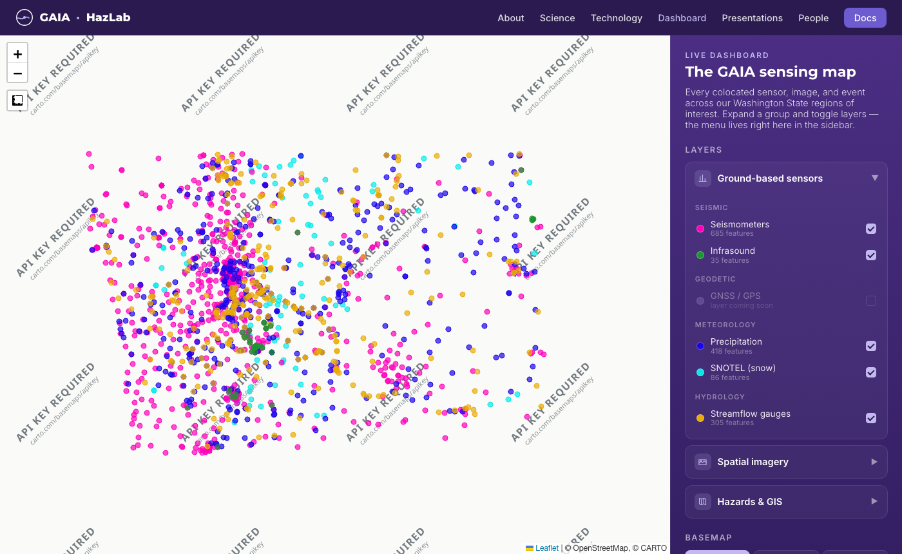
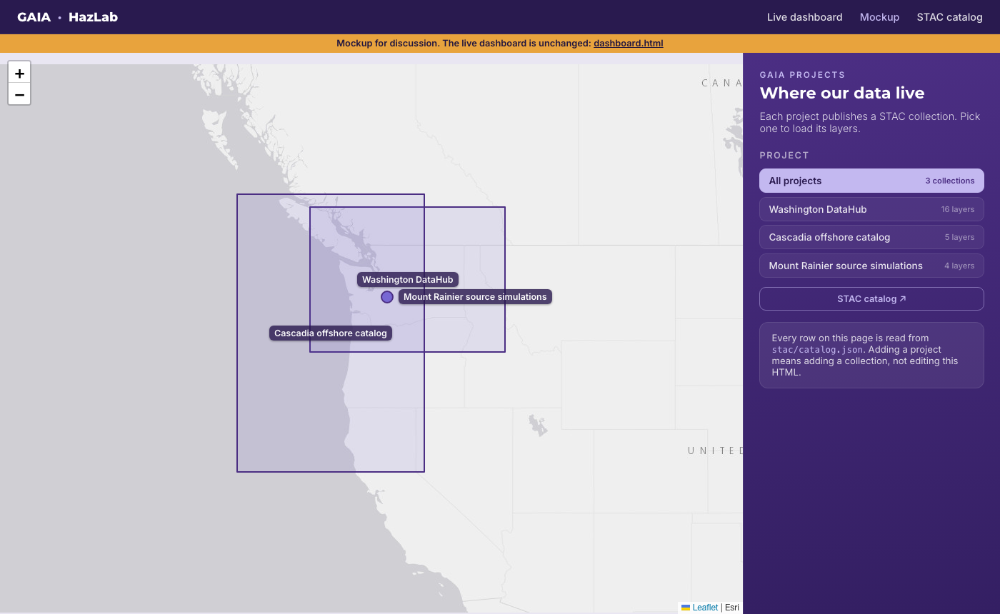
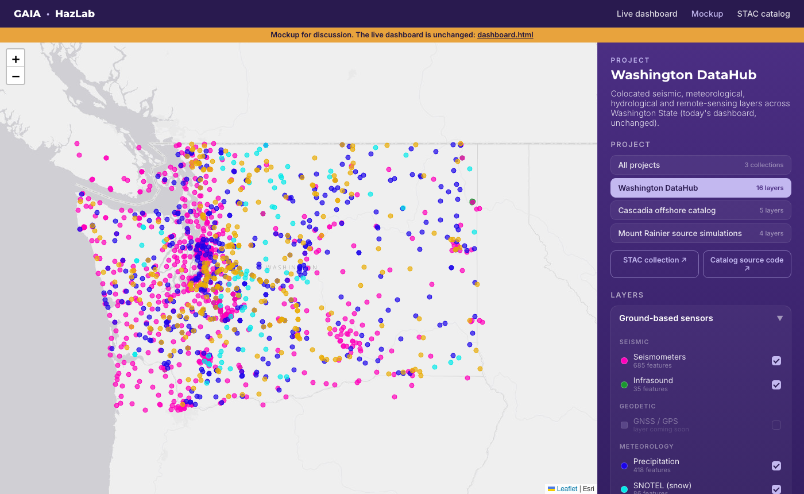
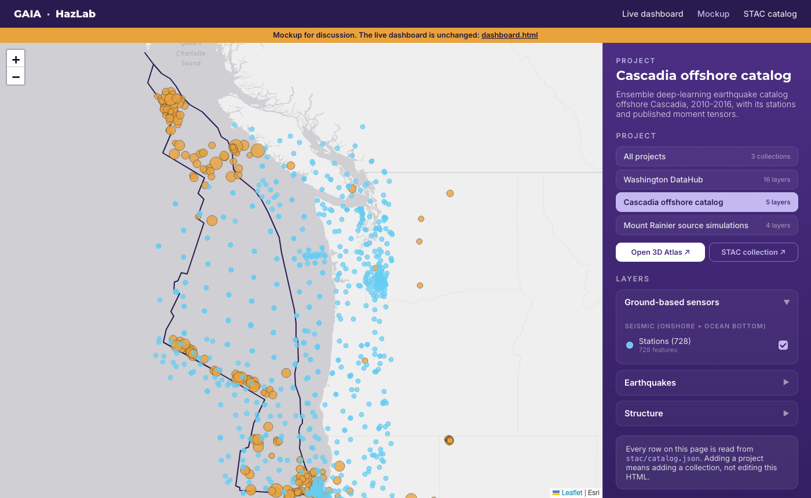
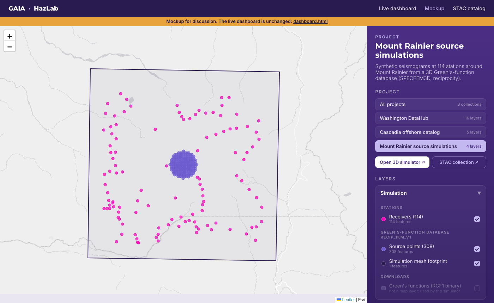

# Dashboard driven by STAC: proposal and mockup

> **Status: proposal for review.** Nothing live changes. The mockup sits at
> `website/mockups/dashboard-stac/`, next to the live `website/dashboard.html`, which this proposal
> leaves untouched.

## The problem

The dashboard (`website/dashboard.html`) lists its layers in a JavaScript array written into the
page: 17 layers, a Washington-only map extent, and the data-provider links. Showing another
project's data means editing that HTML. Two lab projects already publish map-shaped data, and each
does it its own way:

| Project | Site | Layer list | Data |
|---|---|---|---|
| Washington DataHub | `gaia-hazlab.github.io/dashboard.html` | array in the HTML (17 layers) | GeoJSON in `gaia-hazlab/catalog`, COG and WMS by URL |
| Cascadia offshore catalog | `denolle-lab.github.io/cascadia_obs_ensemble/` | array in the HTML (10 layers) | all inlined in one 10.8 MB page |
| Mount Rainier source simulations | `denolle-lab.github.io/mt-rainier-source-simulation/` | `config.json` (3 databases) | release asset in its own binary format (RGF1) |

The DataHub already uses static STAC for its rasters
([datahub-integration-guide](../book/chapters/datahub-integration-guide.md)). The proposal applies
the same choice to the dashboard.

## The proposal

Each project publishes a static STAC collection, and the dashboard reads a root catalog that
links to them. Each collection holds one item per map layer. The page builds its menu, map extent
and links from the catalog, so adding a project means adding a collection, not editing the HTML.

The dashboard stays a 2D discovery map. 3D views (the Cascadia Atlas, the Rainier simulator) stay
in their own repositories, and the dashboard links to them through each collection's
`rel: alternate` link.

How a layer is drawn:

| Layer type | STAC encoding |
|---|---|
| GeoJSON (stations, events, polygons) | asset with `type: application/geo+json` |
| Cloud-optimized GeoTIFF (COG) | asset plus the [render extension](https://github.com/stac-extensions/render) (rescale, colormap), tiled by titiler |
| WMS, XYZ tiles | item link from the [web-map-links extension](https://github.com/stac-extensions/web-map-links) |
| Menu group, color, marker style, default on/off | `gaia:` properties (no schema yet) |

## The mockup

*Today, deployed site, 2026-11-24. The CARTO basemap now returns "API key required" tiles. That
bug is separate from this proposal.*

What the mockup contains (built by `scripts/mockup/build_dashboard_stac.py`):

| Collection | Items | Data |
|---|---|---|
| `washington` | 16 (today's 17 minus the basemap-label overlay) | the same URLs as the live page, not copied |
| `cascadia-offshore` | 5 (3 drawable) | 728 stations, 253 moment tensors, 4 plate boundaries, taken from the Atlas page built 2026-11-22 |
| `mt-rainier` | 4 (3 drawable) | 114 receivers, 308 source points, mesh outline, taken from `gfdb/recip_1km_v1/index.json` (built 2026-11-05) |

The Cascadia events (172,340, catalog v4) are not copied here. They exist only inside the Atlas
page, and the catalog paper is not out yet. The mockup lists them as a disabled layer.

## Steps, each its own PR

1. **This PR.** Mockup, catalog generator, this page. No change to the live site.
2. Live dashboard reads the `washington` collection: same layers, same look. Also fixes the
   basemap.
3. Cascadia: split the Atlas data out of the page into files, and publish a collection from its
   own repository.
4. Rainier: publish a collection from its own repository (receivers, source points, mesh, database
   index).
5. Later, a separate decision: one shared 3D viewer for the projects that need one.

## Questions for the reviewer

1. One item per layer, or collection-level assets? Items give each layer a footprint and make it
   searchable. Collection assets are flatter.
2. Styling and menu hints: should we publish a small `gaia:` extension schema, or is there an
   existing convention for vector styling in STAC?
3. Live third-party endpoints (ArcGIS feature queries, NASA GIBS WMS) as assets: acceptable, or
   should we snapshot them to object storage?
4. Where collections live: in each project repository with a GAIA root catalog linking them, or in
   one catalog repository?
5. For 172,340 events on a 2D web map: GeoParquet, FlatGeobuf or PMTiles?

## Not checked yet

- The catalog has not been run through `stac-validator`.
- The mockup has no basemap switcher or measure tool. The live page has both.
