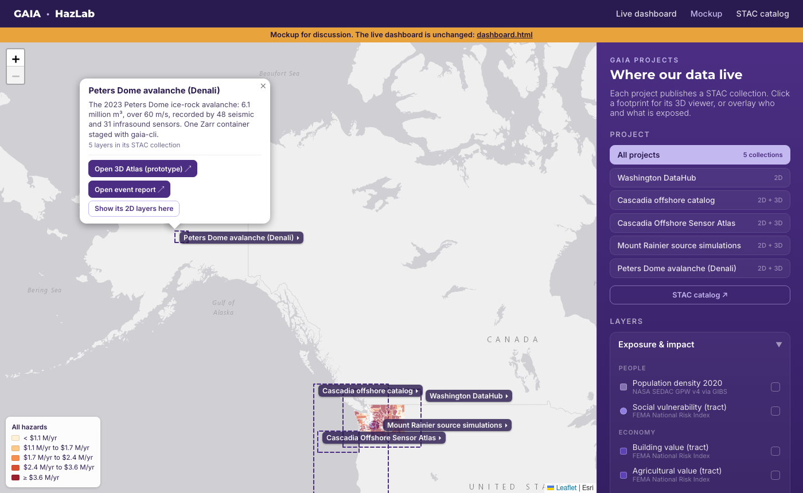
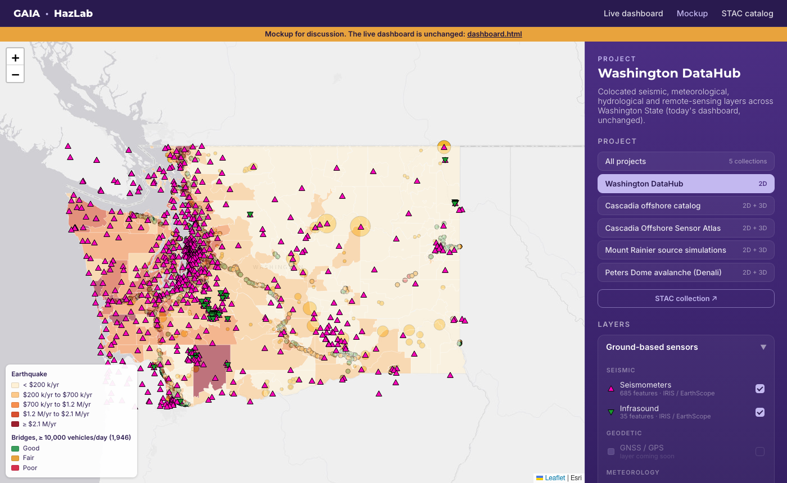
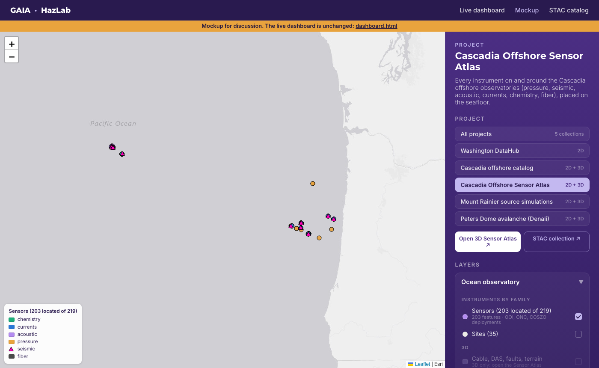
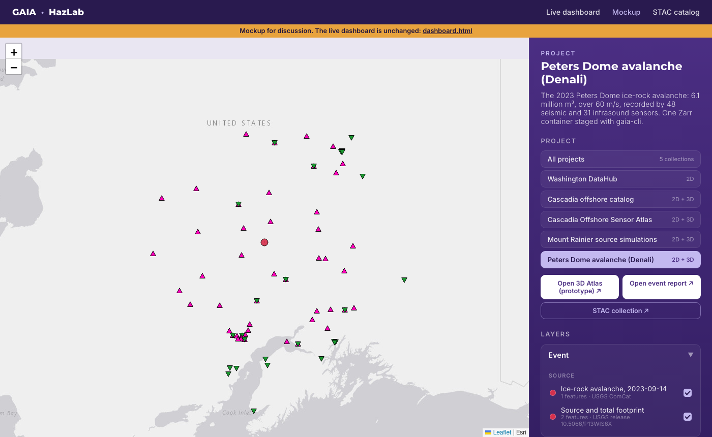

# Dashboard driven by STAC: proposal and mockup

> **Status: proposal for review.** Nothing live changes. The mockup sits at
> `website/mockups/dashboard-stac/`, next to the live `website/dashboard.html`, which this proposal
> leaves untouched.

## The problem

The dashboard (`website/dashboard.html`) lists its layers in a JavaScript array written into the
page: 17 layers, a Washington-only map extent, and the data-provider links. Showing another
project means editing that HTML. Meanwhile the lab's projects each publish their own 3D viewer,
and nothing points from one to the next.

| Project | 3D viewer | Data behind it |
|---|---|---|
| Washington DataHub | none | GeoJSON in `gaia-hazlab/catalog`, COG and WMS by URL |
| Cascadia offshore catalog | `denolle-lab.github.io/cascadia_obs_ensemble/` | inlined in one 10.8 MB page |
| Cascadia Offshore Sensor Atlas | `coszo.org/atlas/` | JSON bundle (`atlas/sensors.json`, 219 sensors) |
| Mount Rainier | `…/mt-rainier-source-simulation/`, `…/mt-rainier-digital-model/` | release asset (RGF1), data bundle |
| Peters Dome avalanche (Denali) | `gaia-hazlab.github.io/gaia-peters-dome/atlas/` (prototype, gaia-peters-dome#6) | one Zarr container staged with gaia-cli |

## The proposal

**One 2D map that leads to every 3D viewer.** Each project publishes a static STAC collection; the
dashboard reads a root catalog that links them. The 2D map shows footprints and the light layers
(stations, events, outlines). Clicking a footprint, or any feature inside a project, opens a card
with that project's 3D viewers (the collection's `rel: alternate` links). 3D rendering stays in the
project repositories.

**Exposure and impact stay 2D and shared.** A context collection overlays who and what is exposed
on every view, read live from public services (Washington only for now):

| Layer | Source | Washington count |
|---|---|---|
| Population density 2020 | NASA SEDAC GPW v4, via GIBS WMS | raster |
| Social vulnerability, building value, agricultural value | FEMA National Risk Index, census tracts | 1,772 tracts |
| Expected annual loss: all hazards, earthquake, landslide, volcanic, wildfire | FEMA National Risk Index | 1,772 tracts |
| Power plants | US EIA | 142 |
| Transmission lines ≥ 230 kV | HIFLD / EIA | 568 |
| Bridges carrying ≥ 10,000 vehicles/day, by condition | FHWA National Bridge Inventory | 1,946 |
| Rail mainlines | FRA North American Rail Network | 1,906 segments |

How a layer is encoded:

| Layer type | STAC encoding |
|---|---|
| GeoJSON (stations, events, polygons, ArcGIS feature queries) | asset, `type: application/geo+json` |
| Cloud-optimized GeoTIFF | asset plus the [render extension](https://github.com/stac-extensions/render) |
| WMS, XYZ tiles | item link from the [web-map-links extension](https://github.com/stac-extensions/web-map-links) |
| 3D viewers, reports | collection link, `rel: alternate`, `type: text/html` |
| Menu group, colors, choropleth breaks, shared context | `gaia:` fields (no schema yet) |

## Marker convention for every GAIA atlas

The same sensor gets the same marker in the 2D dashboard and in every 3D atlas, at the same size on
screen whatever the zoom. In STAC it is `gaia:style.symbol` (or `symbols` by category).

| Sensor | Marker | Size | Edge |
|---|---|---|---|
| Seismometer | ▲ upright triangle (`triangle-up`) | 12 px | black, 1 px |
| Infrasound | ▼ inverted triangle (`triangle-down`) | 12 px | black, 1 px |
| Other point sensors (met, hydro, snow) | ● circle | 8 px | black, 1 px |

Seismometers as upright triangles is the common convention. Infrasound has none: the IMS network is
drawn with inverted triangles in seismo-acoustic papers, the Alaska Earthquake Center uses circles for
infrasound-only sites, and an AVO map uses diamonds. We use the inverted triangle so ground and air
sensors read as a pair. Applied so far in this mockup and in the Peters Dome atlas
(gaia-peters-dome#6); the Cascadia, COSZO and Rainier atlases would adopt it in their own repositories.

## The mockup

Today's live dashboard, for comparison (its CARTO basemap was fixed in #67 after this screenshot):

The catalog is built by `scripts/mockup/build_dashboard_stac.py`: 6 collections, 46 items. Project
layers are small GeoJSON snapshots (563 KB in all), each collection naming its source and date in
`gaia:derived_from`. The Cascadia events (172,340, catalog v4) are not copied: the catalog paper is
not out, and the events exist only inside the Atlas page.

URL parameters make any view shareable: `?project=<id>`, `?on=<layer ids>`, `?card=<id>`.

## Steps, each its own PR

1. **This PR.** Mockup, catalog generator, this page. No change to the live site.
2. Peters Dome 3D Atlas prototype (gaia-peters-dome#6), the first viewer built for this pattern.
3. Live dashboard reads the catalog: same Washington layers and look, plus exposure and project
   footprints.
4. Each project publishes its own collection from its own repository (Cascadia first: move the Atlas
   data out of the page into files). The dashboard then links to them instead of copying snapshots.
5. Exposure layers beyond Washington (Oregon, Alaska), paging past the 2,000-record service limit.

## Questions for the reviewer

1. One item per layer, or collection-level assets?
2. Styling, menu and context hints: publish a small `gaia:` extension schema, or use an existing convention?
3. Live third-party endpoints (ArcGIS feature queries, NASA GIBS WMS) as assets: acceptable, or snapshot them to object storage?
4. Where collections live: in each project repository with a GAIA root catalog, or in one catalog repository?
5. For 172,340 events on a 2D web map: GeoParquet, FlatGeobuf or PMTiles?

## Not checked yet

- The catalog has not been run through `stac-validator`.
- The mockup has no basemap switcher or measure tool. The live page has both.
- Transmission lines that cross Washington are returned whole, so some run south into Oregon and California.
